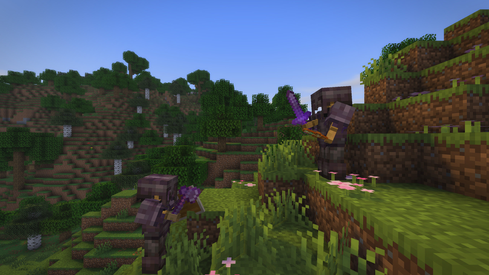
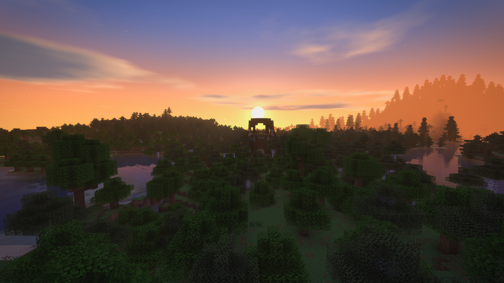
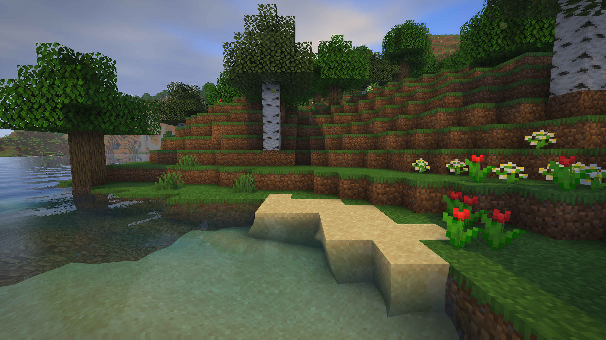
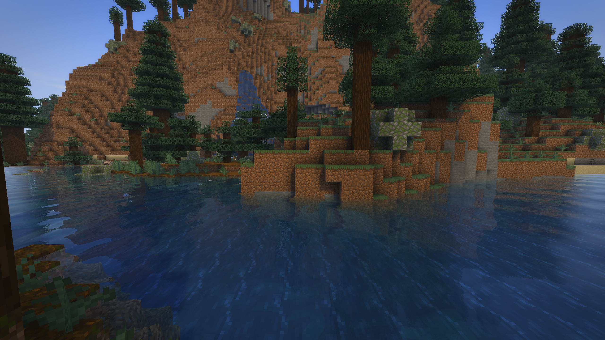
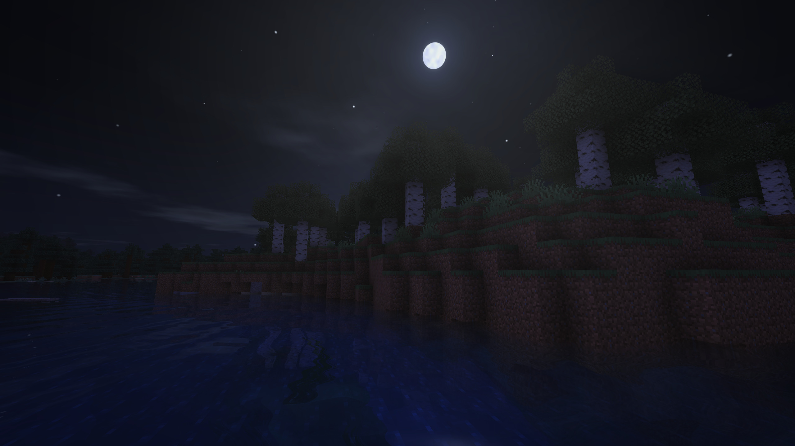
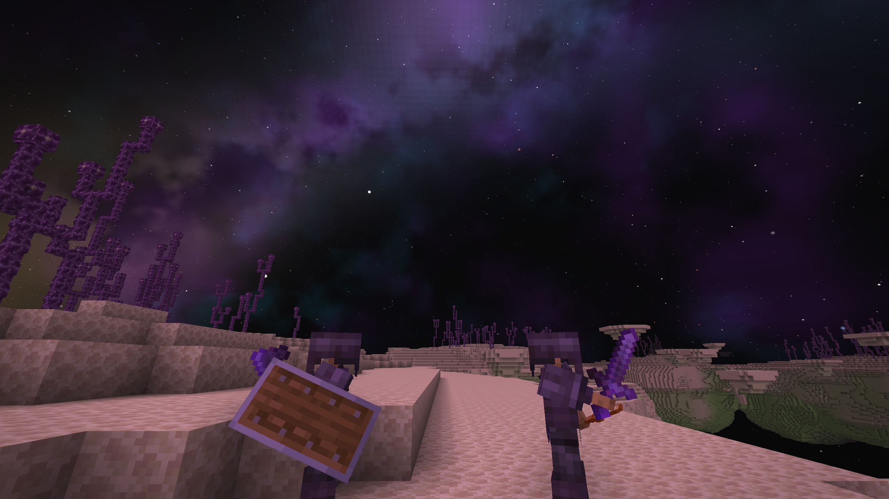
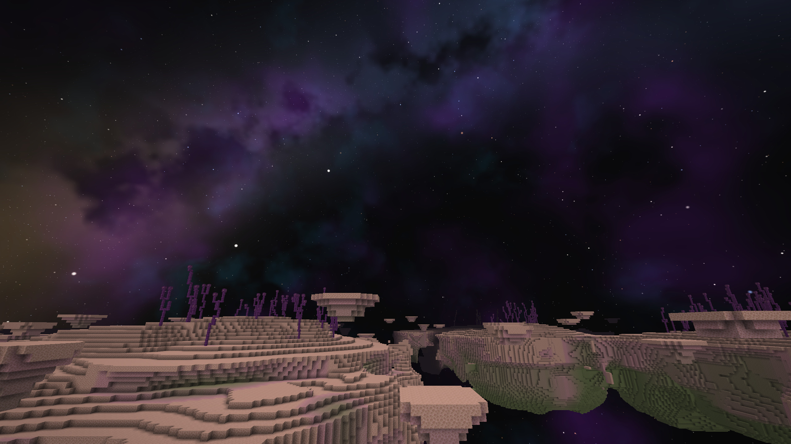

# Lumina

Shaders for [VulkanMod](https://modrinth.com/mod/vulkanmod). Lumina is a Fabric mod that adds its own lightweight
shader pipeline on top of VulkanMod's renderer: sun shadows, warm lighting, water, a new sky, bloom and colour grading.
No shader packs are needed: everything is on out of the box and tuned from one settings screen.

**Русская версия: [README_RU.md](README_RU.md)**


## Screenshots

| Shaders off | Shaders on |
| --- | --- |
|  |  |

| | |
| --- | --- |
| <br>Netherite duel at sunrise | <br>Cherry grove |
| <br>Sunrise over the lake | <br>Sunrise on the river |
| <br>Clear water | <br>Flower forest |
| <br>Taiga | <br>Moonlit night |
| <br>Nether | <br>The End |
| <br>End islands under the nebula |  |

All screenshots are taken at 2560×1440 with the default look of the mod.

## Features

**Shadows**
- Sun and moon shadows for terrain, players and mobs, with adjustable quality (1024 / 2048 / 4096), distance, darkness and softness
- Contact shadows for small details the shadow map is too coarse for
- Screen-space ambient occlusion in corners and crevices
- Players, mobs, block entities and the hand are lit and shadowed like the terrain

**Light and colour**
- Warm sunlight with separate sun and ambient brightness
- Bloom and sun rays
- Colour grading: warmth, saturation, contrast, brightness, vignette, sharpness

**Water and reflections**
- Rippling water with adjustable wave height
- Reflections on ice and stained glass
- Puddles that appear on the ground in the rain
- Lava that glows on its own and churns slowly

**Sky**
- Overworld sky with atmosphere, a round sun, a moon with phases and stars
- Soft clouds with adjustable cover
- A separate sky for the End

**World**
- Waving grass, plants and leaves

**Performance**
- Crowd optimisation: when a lot of creatures are around, only the nearest ones are drawn (the limit is adjustable)
- Every effect can be switched off separately

## Requirements

| | |
| --- | --- |
| Minecraft | 1.21.11 |
| Mod loader | [Fabric Loader](https://fabricmc.net/use/) 0.17.0 or newer |
| Required mods | [VulkanMod](https://modrinth.com/mod/vulkanmod) 0.6.8 or newer, [Fabric API](https://modrinth.com/mod/fabric-api) |
| Optional | [Mod Menu](https://modrinth.com/mod/modmenu), opens the settings from the mod list |

Client-side only. Not compatible with Beryl.

## Installation

1. Install Fabric Loader for Minecraft 1.21.11.
2. Put VulkanMod, Fabric API and the Lumina jar into the `mods` folder.
3. Start the game. The shaders are on by default.

## Controls and settings

| Key | Action |
| --- | --- |
| `F10` | Toggle the shaders |
| `F9` | Open the shader settings |

Both keys can be rebound in the game's key bind settings, under *Lumina Shaders*. The settings screen is also available
through Mod Menu and has six tabs: General, Shadows, Light & colour, Water, Sky and Performance.

Settings are stored in `config/lumina.json`. The mod is translated into English and Russian.

## Troubleshooting

If something goes wrong while rendering, Lumina switches itself off instead of crashing the game and writes the reason
to `logs/lumina.log`. Press `F10` to try again. Please attach that file when you report a problem.

## Building from source

Java 21 is required.

1. Put the jars listed in [libs/README.md](libs/README.md) into `libs/`.
2. Build:

```bash
./gradlew build
```

The mod jar appears in `build/libs/`.

### Development tools

The `dev` source set (`src/dev`) is not packaged into the mod. It plays back a script in a singleplayer world (server
commands, config changes, screenshots, FPS readings) so that rendering changes can be checked without touching the
keyboard. Example scripts are in [devscripts/](devscripts); the script commands are described in
[DevScript.java](src/dev/java/dev/lumina/dev/DevScript.java).

```bash
./gradlew runDevClient -PluminaScript=/absolute/path/to/script.txt -PluminaNewWorld=TestWorld -PluminaSeed=2026
```

`-PluminaNewWorld` generates a fresh world with that name, or opens it if it already exists; without it the client
opens the save called `New World`. `-PluminaWidth` and `-PluminaHeight` set the window size. The `prodClient` task runs
the remapped release jar together with the mods from `prodmods/`, the way a launcher would.

## License

[MIT](LICENSE) © kerzo1x. Do whatever you want with the code, just keep the copyright notice and mention **kerzo1x**
as the original author.

The files in `src/main/resources/assets/minecraft/shaders` are modified copies of Minecraft's own shaders, which belong
to Mojang. VulkanMod is a separate project under its own license and is not included in this repository.
