# Lumina

Шейдеры для [VulkanMod](https://modrinth.com/mod/vulkanmod). Lumina — мод для Fabric, который добавляет поверх рендера
VulkanMod собственный лёгкий шейдерный конвейер: тени от солнца, тёплый свет, воду, новое небо, свечение и
цветокоррекцию. Шейдерпаки не нужны: всё включено сразу и настраивается на одном экране.

**English version: [README.md](README.md)**

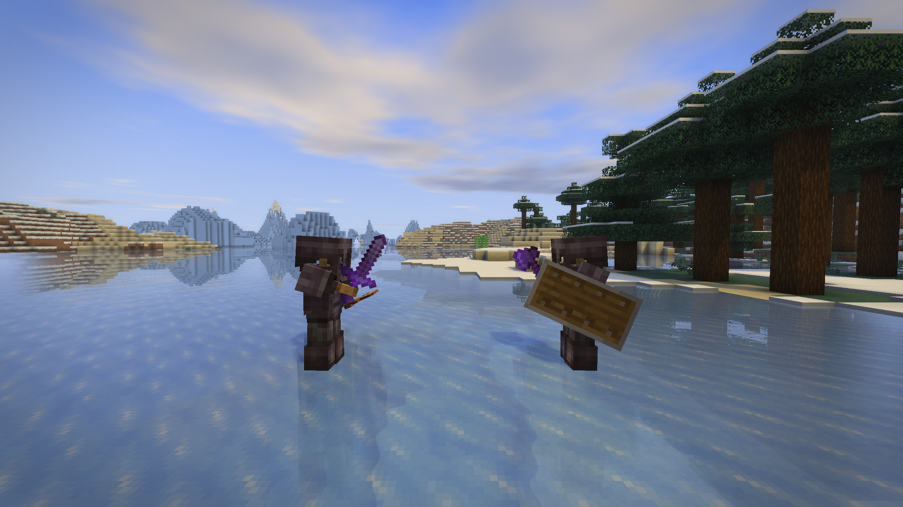

## Скриншоты

| Шейдеры выключены | Шейдеры включены |
| --- | --- |
| 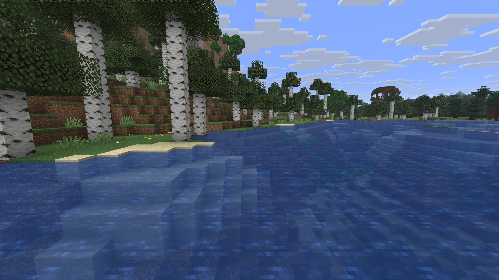 | 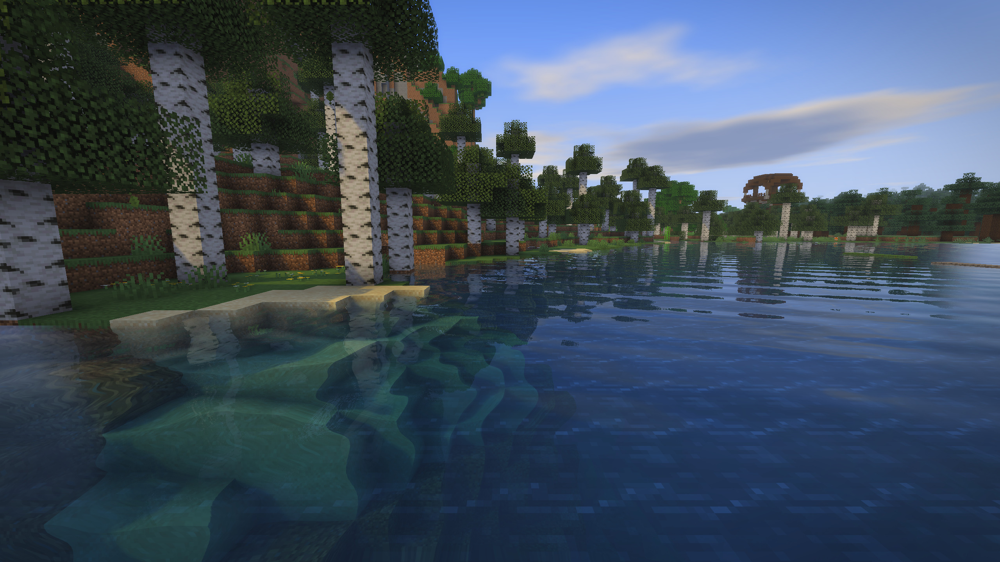 |

| | |
| --- | --- |
| 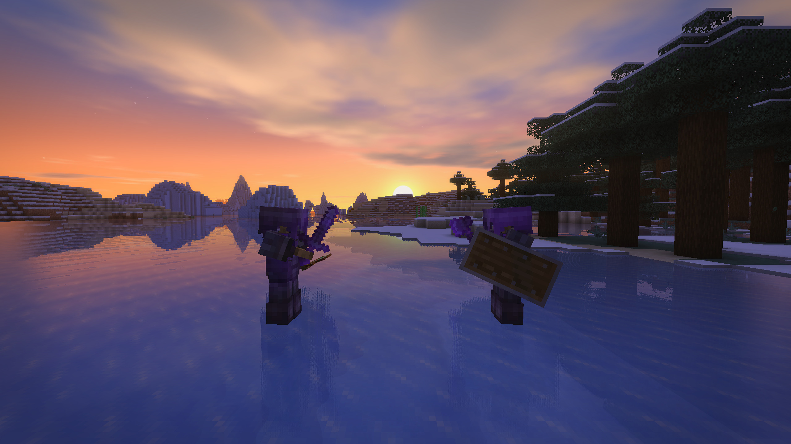<br>Дуэль в незерите на рассвете | 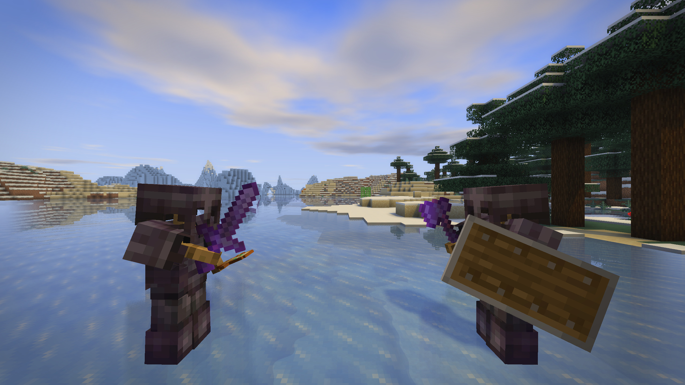<br>Зачарованный незерит вблизи |
| <br>Вишнёвая роща | <br>Рассвет над озером |
| 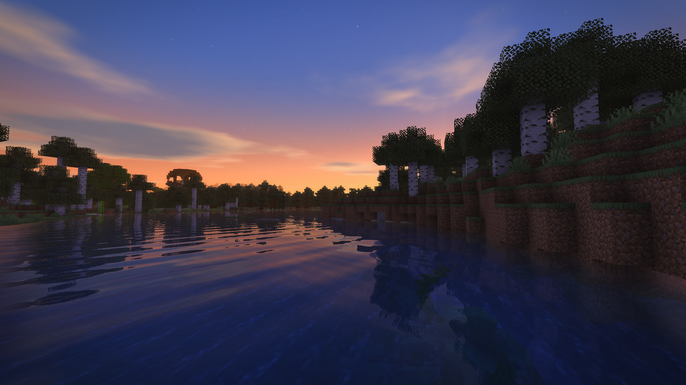<br>Рассвет на реке | <br>Прозрачная вода |
| <br>Цветочный лес | <br>Тайга |
| 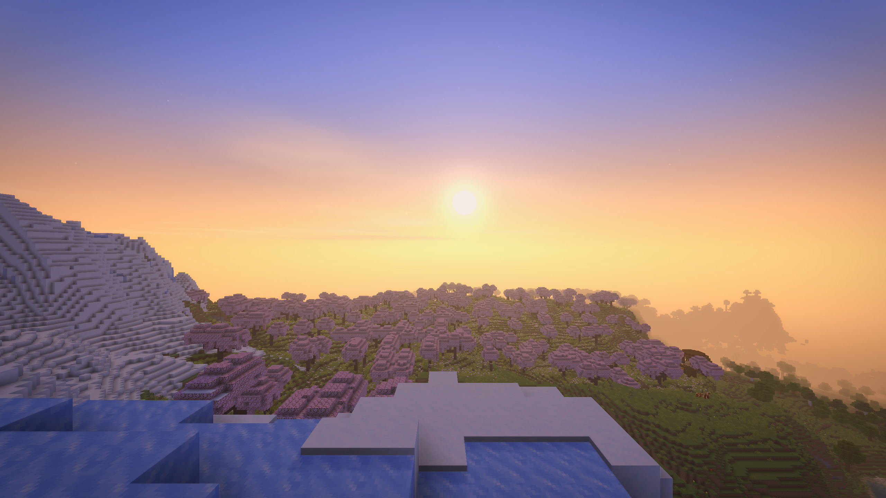<br>Рассвет с горных пиков | <br>Лунная ночь |
| 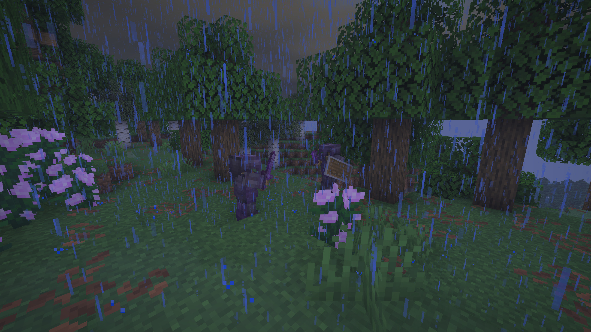<br>Дождь | 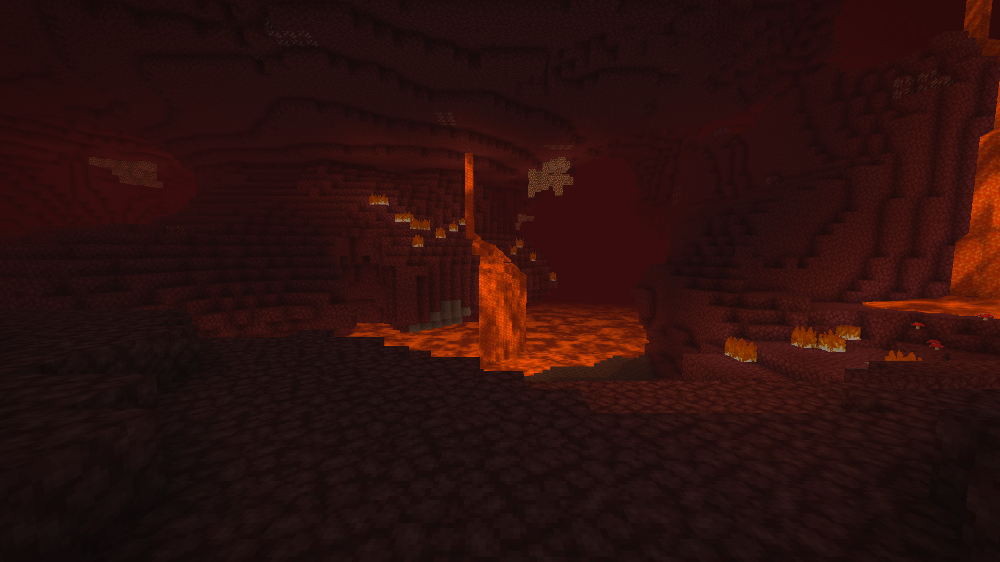<br>Незер |
| 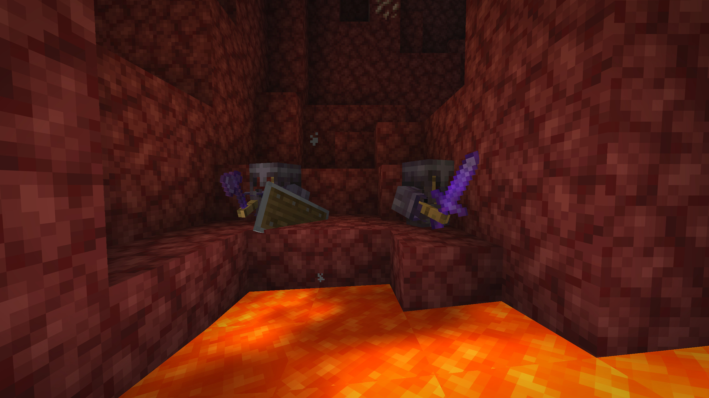<br>Незер, у лавы | 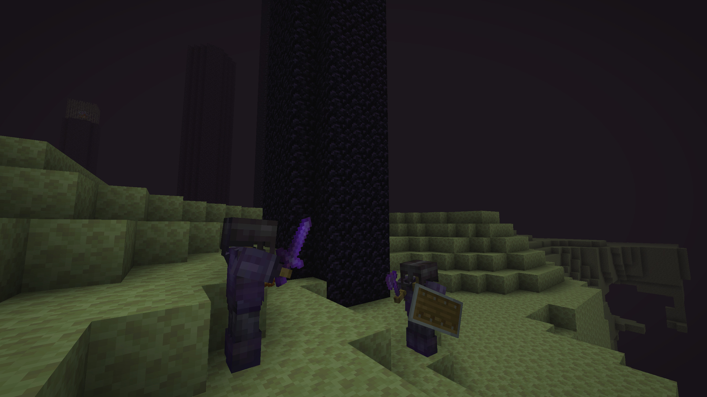<br>Энд |

Все скриншоты сняты в 2560×1440 со стандартным видом мода.

## Возможности

**Тени**
- Тени от солнца и луны для мира, игроков и мобов; настраиваются качество (1024 / 2048 / 4096), дальность, темнота и мягкость
- Контактные тени для мелких деталей, на которые не хватает разрешения карты теней
- Затенение углов и щелей (AO)
- Игроки, мобы, блок-сущности и рука освещаются и затеняются так же, как мир

**Свет и цвет**
- Тёплый солнечный свет, отдельная яркость солнца и общей освещённости
- Свечение (bloom) и лучи солнца
- Цветокоррекция: теплота, насыщенность, контраст, яркость, виньетка, резкость

**Вода и отражения**
- Вода с рябью, высота волн настраивается
- Отражения на льду и цветном стекле
- Лужи на земле во время дождя
- Лава, которая светится сама и медленно бурлит

**Небо**
- Небо обычного мира: атмосфера, круглое солнце, луна с фазами, звёзды
- Мягкие облака с настраиваемой облачностью
- Отдельное небо для Энда

**Мир**
- Колыхание травы, растений и листвы

**Оптимизация**
- Оптимизация толпы: когда вокруг много существ, рисуются только ближайшие (предел настраивается)
- Любой эффект можно отключить отдельно

## Требования

| | |
| --- | --- |
| Minecraft | 1.21.11 |
| Загрузчик | [Fabric Loader](https://fabricmc.net/use/) 0.17.0 или новее |
| Обязательные моды | [VulkanMod](https://modrinth.com/mod/vulkanmod) 0.6.8 или новее, [Fabric API](https://modrinth.com/mod/fabric-api) |
| По желанию | [Mod Menu](https://modrinth.com/mod/modmenu), открывает настройки из списка модов |

Мод только клиентский. Несовместим с Beryl.

## Установка

1. Установите Fabric Loader для Minecraft 1.21.11.
2. Положите VulkanMod, Fabric API и jar Lumina в папку `mods`.
3. Запустите игру. Шейдеры включены по умолчанию.

## Управление и настройки

| Клавиша | Действие |
| --- | --- |
| `F10` | Включить или выключить шейдеры |
| `F9` | Открыть настройки шейдеров |

Клавиши меняются в настройках управления игры, в разделе «Шейдеры Lumina». Экран настроек также открывается через
Mod Menu, в нём шесть вкладок: «Основное», «Тени», «Свет и цвет», «Вода», «Небо» и «Оптимизация».

Настройки хранятся в `config/lumina.json`. Мод переведён на русский и английский.

## Если что-то пошло не так

При ошибке рендера Lumina отключается сама, не роняя игру, и записывает причину в `logs/lumina.log`. Нажмите `F10`,
чтобы попробовать снова. Приложите этот файл, когда сообщаете о проблеме.

## Сборка из исходников

Нужна Java 21.

1. Положите в `libs/` jar-файлы, перечисленные в [libs/README.md](libs/README.md).
2. Соберите мод:

```bash
./gradlew build
```

Готовый jar появится в `build/libs/`.

### Инструменты разработки

Набор исходников `dev` (`src/dev`) в мод не попадает. Он проигрывает сценарий в одиночном мире (серверные команды,
смена настроек, скриншоты, замеры FPS), чтобы проверять изменения рендера, не трогая клавиатуру. Примеры сценариев
лежат в [devscripts/](devscripts), команды описаны в [DevScript.java](src/dev/java/dev/lumina/dev/DevScript.java).

```bash
./gradlew runDevClient -PluminaScript=/absolute/path/to/script.txt -PluminaNewWorld=TestWorld -PluminaSeed=2026
```

`-PluminaNewWorld` создаёт новый мир с таким именем или открывает его, если он уже есть; без этого параметра клиент
открывает сохранение `New World`. `-PluminaWidth` и `-PluminaHeight` задают размер окна. Задача `prodClient` запускает
собранный jar вместе с модами из `prodmods/`, как это сделал бы лаунчер.

## Лицензия

[MIT](LICENSE) © kerzo1x. С кодом можно делать что угодно, только сохраняйте уведомление об авторских правах и
упоминайте **kerzo1x** как автора оригинала.

Файлы в `src/main/resources/assets/minecraft/shaders` — изменённые копии шейдеров самой Minecraft, они принадлежат
Mojang. VulkanMod — отдельный проект со своей лицензией, в этот репозиторий он не входит.
